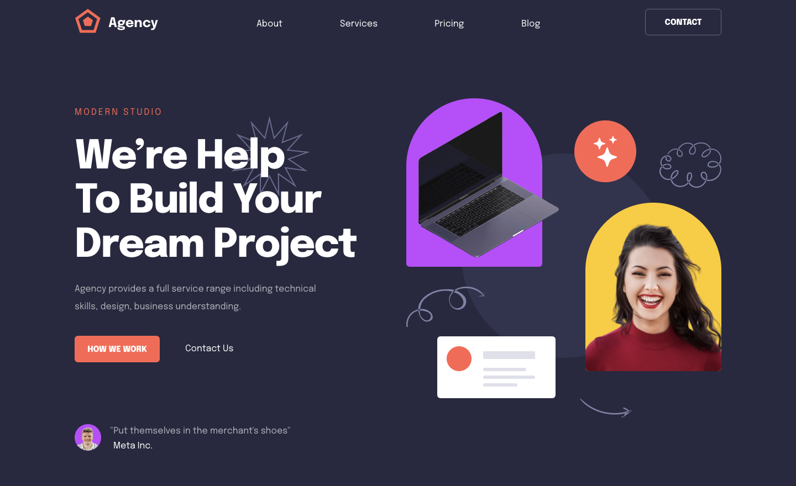

# figma-to-html

A pixel-perfect, hand-coded conversion of an 8-page agency website from Figma to
**semantic HTML and pure CSS** — no framework, no build step, and **zero JavaScript**.

**Live demo:** https://thanhcongmssl.github.io/figma-to-html/

<p align="center">
  
  &nbsp;
  
</p>

## Highlights

- **Pixel-perfect** — every page matches its Figma frame at both 1440px (desktop)
  and 375px (mobile), with 97.6–99.6 % of pixels within tolerance.
- **Zero JavaScript** — all interactivity is done in CSS:
  - portfolio filter with radio inputs + `:has()`
  - FAQ and services accordions with `<details name="…">` (opening one closes the others)
  - mobile menu with a checkbox toggle
  - team carousel with `scroll-snap`
- **No flexbox, no grid, no `gap`** — layouts are built with classic techniques
  (`float` + `calc()`, `flow-root`, `inline-block`, `position`), as a deliberate challenge.
- **Clean CSS architecture** — cascade layers (`reset, tokens, base, layout, components, utilities`),
  BEM naming, flat specificity, design tokens, and no `!important`.
- **Fully responsive** — tested at 17 widths from 320px to 2560px plus landscape phones,
  with no horizontal scrolling at any size.
- **Accessible** — semantic landmarks, skip link, visible focus styles, 44px touch targets,
  and support for `prefers-reduced-motion`.
- **Self-hosted font** — Epilogue (SIL OFL) as a variable `.woff2`, with baseline
  overrides so text sits exactly where Figma puts it.

## Pages

| Page | File | Desktop match | Mobile match |
| --- | --- | --- | --- |
| Home | `index.html` | 98.9 % | 98.0 % |
| About | `about.html` | 99.1 % | 97.6 % |
| Services | `services.html` | 99.0 % | 97.6 % |
| Portfolio | `portfolio.html` | 99.6 % | 98.6 % |
| Single Project | `single-project.html` | 99.4 % | 98.0 % |
| Blog | `blog.html` | 99.3 % | 98.7 % |
| Single Post | `single-post.html` | 99.1 % | 97.7 % |
| Contact | `contact.html` | 99.3 % | 98.4 % |

_Match = share of pixels whose color differs from the Figma export by ≤ 30 (out of 765).
Most remaining differences are font anti-aliasing._

## Figma vs. build

Full-page side-by-side comparisons (Figma on the left, browser render on the right) are in
[`docs/comparison/`](docs/comparison/). Each page folder also has an overlay and a difference image,
for example:

- [Home — desktop](docs/comparison/home/home-side-by-side.png) ·
  [mobile](docs/comparison/home-mobile/home-mobile-side-by-side.png)
- [Portfolio — desktop](docs/comparison/portfolio/portfolio-side-by-side.png) ·
  [mobile](docs/comparison/portfolio-mobile/portfolio-mobile-side-by-side.png)
- [Contact — desktop](docs/comparison/contact/contact-side-by-side.png) ·
  [mobile](docs/comparison/contact-mobile/contact-mobile-side-by-side.png)

You can also compare live: open `dev/<page>-overlay.html` (for example `dev/home-overlay.html`)
to overlay the Figma design on the real page. It has four modes: Code only, 50 % overlay,
Figma only, and a drag slider.

## Project structure

```
*.html                 one file per page (desktop and mobile share the same file)
css/
├── reset.css          modern reset
├── fonts.css          self-hosted Epilogue + baseline overrides
├── tokens.css         design tokens: colors, type scale, radii, motion
├── base.css           element defaults
├── layout.css         container and sections
├── components/        one BEM file per component
└── utilities.css      single-purpose helpers
assets/                fonts, icons, images
dev/                   Figma overlay tools (internal)
docs/                  preview images and Figma-vs-build comparisons
```

## Run locally

```bash
npm install     # installs browser-sync for live reload
npm run dev     # http://localhost:3000
```

Or, with no dependencies at all:

```bash
python3 -m http.server 3000
```

## Credits

Design based on a free agency portfolio template from the Figma Community.
Font: [Epilogue](https://fonts.google.com/specimen/Epilogue) by Etcetera Type Co., licensed under the SIL Open Font License.
